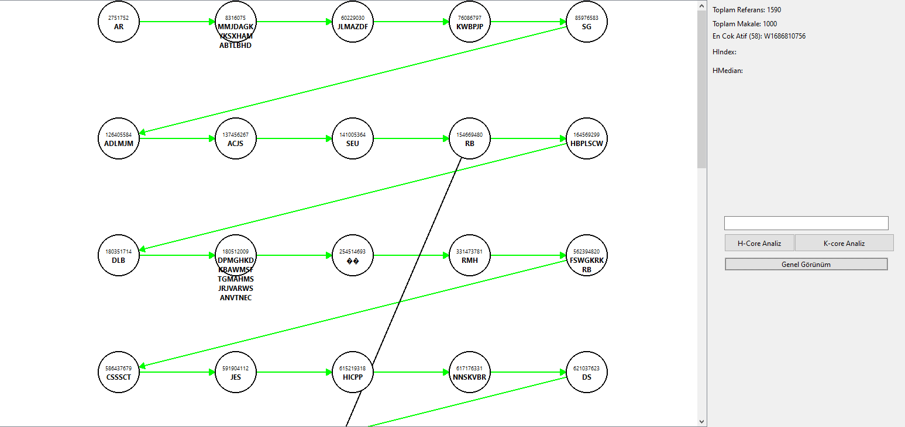
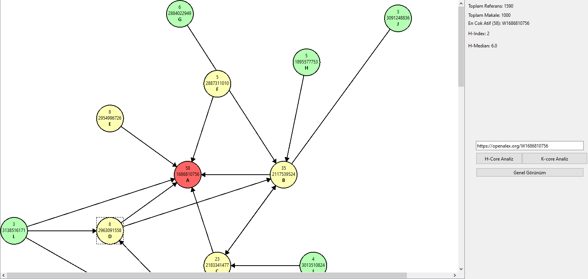
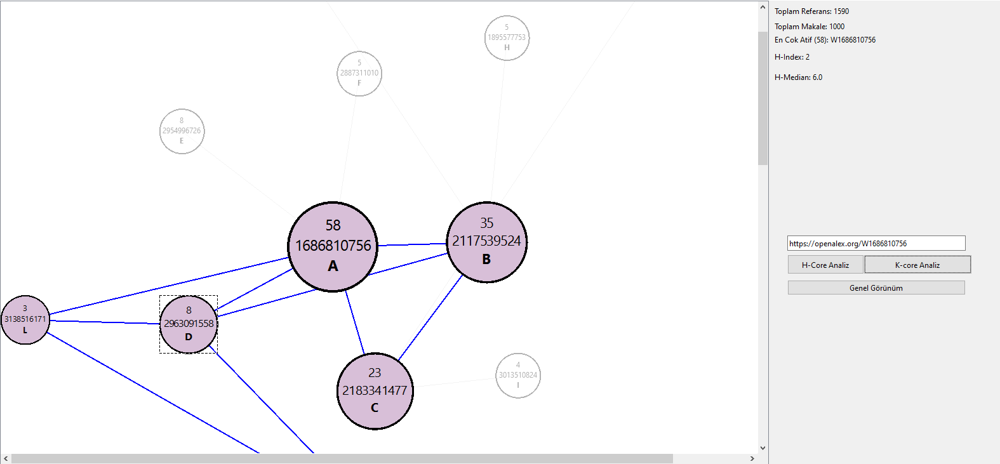

# Makale Analiz Sistemi

Bilimsel makaleler arasındaki atıf ilişkilerini graf olarak çizen ve bu graf üzerinde **H-Index**,
**H-Median**, **ara merkeziyet (betweenness centrality)** ve **K-Core** analizleri yapan bir C++/Qt
masaüstü uygulaması. Bir makaleden başlayıp tıklanan makalelerin H-Core'larıyla graf adım adım
genişletilebilir.

> **EN —** A C++/Qt desktop app that models citation networks from OpenAlex data and draws them
> as an interactive graph. It computes H-Index and H-Median for a selected paper, expands the graph
> through H-Cores on click, and runs Brandes betweenness centrality and iterative K-Core
> decomposition on the visible graph. JSON is parsed by hand, without a JSON library.



- **Dil:** C++17 — veri ve analiz kısmı yalnızca STL (`map`, `set`, `queue`)
- **Arayüz:** Qt 6 Widgets (`QGraphicsView`, `QGraphicsScene`)
- **Veri:** OpenAlex'ten alınmış makale kayıtları (JSON)

Geliştiren: Enes Canlı

## Öne çıkanlar

- **Kütüphanesiz JSON okuma.** Veri dosyası tek seferde belleğe alınır, her `"id"` anahtarından bir
  sonrakine kadar olan blok ayrı bir makale olarak ayrıştırılır; başlık, yıl, yazarlar ve
  referanslar bu bloktan çekilir.
- **H-Core ile genişleyen graf.** Seçilen makaleye atıf yapan makaleler kendi atıf sayılarına göre
  sıralanır; H-Index ve H-Median bu sıradan hesaplanır, H-Core'daki makaleler grafa eklenir.
  Yeni bir düğüme tıklamak grafı o düğümün H-Core'u ile büyütür.
- **Çakışmayan yerleşim.** Yeni düğüm, merkezin çevresinde bir çembere yerleştirilir; başka bir
  düğüme 180 pikselden yakın düşerse yarıçap büyütülüp açı kaydırılarak (spiral) boş yer aranır.
- **Brandes algoritmasıyla ara merkeziyet.** Her düğümden BFS ile en kısa yol sayıları bulunur,
  bağımlılıklar ters sırada toplanır. Köprü konumundaki makaleler daha büyük çizilir.
- **İteratif K-Core.** Derecesi `k`'dan küçük düğümler silinir, komşularının derecesi düşürülür ve
  değişiklik kalmayana kadar tekrarlanır. Çekirdekteki düğümler renklendirilir, dışındakiler
  soluklaşır.

## Çalıştırma

1. Qt Creator'da `MakaleGrafAnaliz/MakaleGrafAnaliz.pro` dosyasını açın (Qt 6, MinGW 64-bit ile
   denendi).
2. Veri dosyası repoda yoktur. OpenAlex biçimindeki `data.json` dosyanızın yolunu
   `MakaleGrafAnaliz/mainwindow.cpp` içindeki `veriyiYukleSafCPP(...)` çağrısına yazın:

   ```cpp
   veriyiYukleSafCPP("C:/yol/data.json");
   ```

3. Projeyi derleyip çalıştırın.

## Kullanım

| Düğme / işlem | Ne yapar |
|---|---|
| Makale ID + **H-Core Analiz** | Makaleyi merkeze koyar, H-Index ve H-Median'ı gösterir, H-Core'u çizer |
| Düğüme tıklama | Grafı o makalenin H-Core'u ile genişletir |
| Düğümün üzerine gelme | Makale bilgisini gösterir |
| **Genel Görünüm** | ID sırasına göre ilk 50 makaleyi referans (siyah) ve ID sırası (yeşil) oklarıyla çizer |
| **K-core Analiz** | Ekrandaki graf üzerinde ara merkeziyet ve K-Core (`k = 2`) hesaplar |

Arayüzde ayrıca toplam makale, toplam referans ve en çok atıf alan makale gösterilir.

## Ekran görüntüleri

| Genel görünüm | H-Core analizi | K-Core analizi |
|---|---|---|
|  |  |  |

## Klasör yapısı

| Yol | İçerik |
|---|---|
| `MakaleGrafAnaliz/mainwindow.cpp` | Veri okuma, H-Index/H-Median, graf çizimi ve genişletme, ara merkeziyet, K-Core |
| `MakaleGrafAnaliz/dugumitem.cpp`, `DugumItem.h` | Graf düğümü: renk, etiket, bilgi kutusu, tıklama |
| `MakaleGrafAnaliz/makale.h` | `Makale` veri yapısı |
| `MakaleGrafAnaliz/mainwindow.ui` | Qt Designer arayüz dosyası |
| `docs/` | Ekran görüntüleri |

## Bilinen sınırlamalar

- Ara merkeziyet ve K-Core tüm veri kümesinde değil, o an ekranda çizili düğümler üzerinde
  hesaplanır.
- K-Core için `k` değeri koda sabittir (`k = 2`).
- Veri dosyasının yolu koda yazılıdır; dosya bulunamazsa graf boş açılır.

## Lisans

MIT
